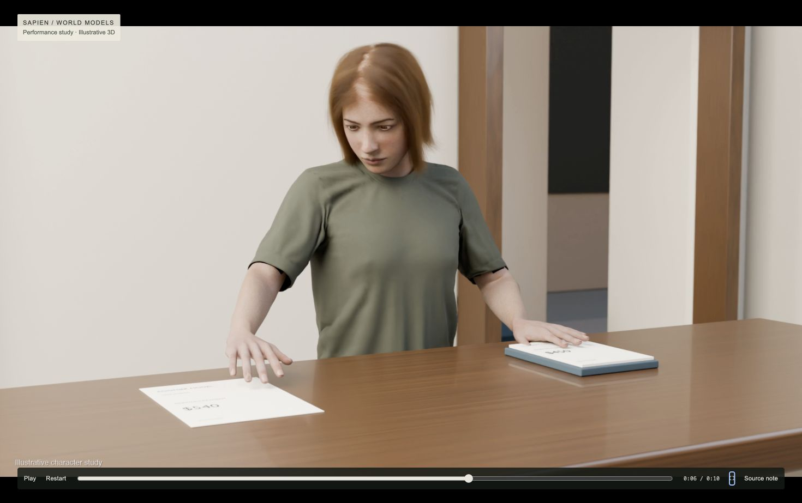
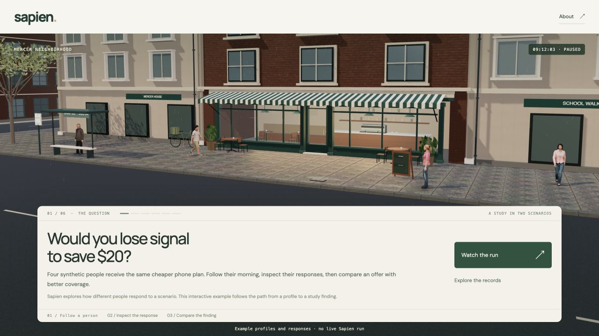

# Sapien visual prototypes

The current work is the [illustrative character performance test](character-study/README.md): a ten-second pre-rendered scene with a runnable browser player, source code, rendering recipes, footage, verification and credits. It is a character test for feedback. The broader World Models experience is unfinished.

```sh
node character-study/server.mjs
```

Open http://127.0.0.1:5194/. No dependencies or API keys are needed for this player.



## Current status

The latest version is the character test in `character-study/`. The earlier neighborhood prototype below is a separate version; its features are not features of the current character test.

### What works now

- A ten-second pre-rendered 3D sequence shows one person comparing a $540 offer with a written $450 limit, moving the offer aside, releasing it and looking up.
- Three shots cover the same continuous moment, with revised gaze, blinks, cloth movement and hand motion.
- The browser player supports play/pause, restart, seeking, fullscreen and source disclosure.
- The repository includes the player code, rendered movie, browser recording, measured playback record, rendering references and credits.
- The full playback check decoded all 240 source frames with zero dropped video frames. This measures video playback, not real-time 3D rendering.

### What it does not do yet

- It does not run a live agent simulation or connect to a simulation backend.
- It does not provide a freely explorable 3D world or let the viewer change a scenario and obtain a new model result.
- It does not establish the person's history, changing circumstances or journey across settings.
- It does not show a definite final choice, a chosen alternative or a later consequence. Moving a paper aside leaves the outcome ambiguous.
- It does not connect individual choices to population patterns, scenario comparisons or research findings.
- The values and response are authored illustrations, not approved study records or measured consumer outcomes.
- The face and hair still look digital in close-up. Dialogue, walking and vehicle interaction are unvalidated.

### Work remaining

1. Select a concrete research question and obtain the profiles, scenarios, actions and results that can be represented. Keep illustrative material labeled until approved records are available.
2. Establish a recognizable person's circumstances through connected settings and visible events.
3. Show meaningful alternatives, an unambiguous choice and its consequence through action.
4. Connect the journey to other responses and a research question or sourced finding. Scenario comparisons need records from both conditions.
5. Improve or replace the close-up character pipeline, validate any additional actions, and review the complete sequence for visual clarity and continuity.
6. Define and build the intended interaction beyond video playback. Package the missing rendering inputs if a standalone scene rebuild is required.

See [STATUS.md](STATUS.md) for the scope and evidence in one place. This repository is a work in progress, not a completed World Models explanation or an official production release.

## Earlier neighborhood prototype

The existing Three.js/Vite neighborhood remains below as an earlier prototype. Its instructions and limitations apply to that version.

## Sapien neighborhood study

An interactive 3D prototype for exploring a study through the people behind its results. Built with Three.js and Vite.



## Run locally

Use Node.js 22.12 or newer.

```sh
npm ci
npm run dev
```

Open the local URL printed in the terminal. No API key, account, or video-generation subscription is needed.

```sh
npm test
npm run build
npm run preview
```

The production build is written to `dist/`. Serve it at a domain root; asset URLs currently start with `/assets/`. This repository does not enable a hosted deployment.

## Explore

1. Choose **Watch the run** to follow the morning until the offer arrives.
2. Inspect a person's circumstances and response, or switch to someone else.
3. Compare coverage scenarios while retaining the same person, camera and paused moment.
4. Pull back to the four-record summary and inspect the responses behind it.
5. Open the separate published-research view from the results or About panel.

The prediction challenge is also available at `/?challenge=coverage`.

## What the data means

The default phone-plan study has four authored profiles and responses. It is an interaction prototype, not a live Sapien simulation, representative population forecast, or evidence about actual consumers. Neighborhood movement and the replay clock are illustrative.

A separate view presents five group-level results from [Sapien's published data-center study](https://www.asksapien.ai/blog/data-center-next-door). Those groups contain different simulated people. The chart does not turn their aggregate results into individual before/after records.

About → Load your own study records accepts the narrow JSON contract in `src/comparison-data.js`. It currently requires four fixed participant IDs and the existing phone-plan offer. A single run can be viewed alone; comparison requires both supplied runs. Imported provenance is labeled unverified. An actual study with a different scenario needs a corresponding schema and scene adaptation.

## Project structure

- `src/main.js`: application navigation and replay controller.
- `src/replay-story-ui.js`: guided study interface.
- `src/neighborhood.js`: 3D world and character playback.
- `src/comparison-data.js`: authored comparison and import validation.
- `src/published-research.js`: source-linked public research view.
- `public/assets/`: bundled characters, motion, surfaces and lighting.
- `public/data/`: sample import files.
- `test/`: data, motion, camera, rendering and geometry checks.

## Assets and attribution

This repository contains the distributable Microsoft Rocketbox characters and credited CC0 scenery assets. Private scan candidates and local research/work files are excluded. Character art remains prototype quality.

Third-party licenses are retained in `public/licenses/`; see [CREDITS.md](CREDITS.md) for sources and modifications. Public repository visibility does not replace those individual licenses. This project is a prototype for review, not an official production release of the Sapien platform.
