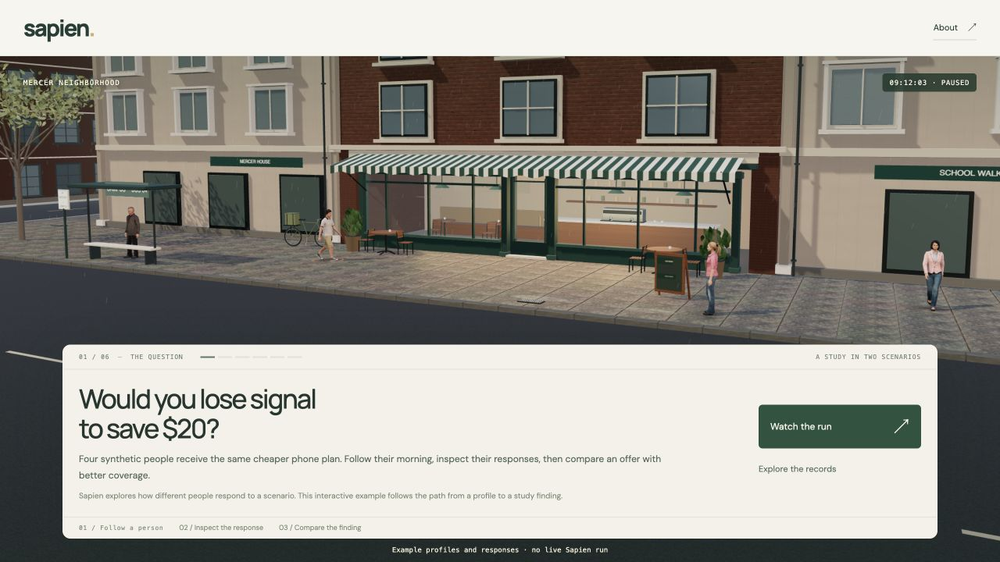

# Sapien neighborhood study

An interactive 3D prototype for exploring a study through the people behind its results. Built with Three.js and Vite.



## Run locally

Use Node.js 22.12 or newer.

```sh
npm ci
npm run dev
```

Open the local URL printed in the terminal. No API key, account, or video-generation subscription is needed.

```sh
npm test
npm run build
npm run preview
```

The production build is written to `dist/`. Serve it at a domain root; asset URLs currently start with `/assets/`. This repository does not enable a hosted deployment.

## Explore

1. Choose **Watch the run** to follow the morning until the offer arrives.
2. Inspect a person's circumstances and response, or switch to someone else.
3. Compare coverage scenarios while retaining the same person, camera and paused moment.
4. Pull back to the four-record summary and inspect the responses behind it.
5. Open the separate published-research view from the results or About panel.

The prediction challenge is also available at `/?challenge=coverage`.

## What the data means

The default phone-plan study has four authored profiles and responses. It is an interaction prototype, not a live Sapien simulation, representative population forecast, or evidence about actual consumers. Neighborhood movement and the replay clock are illustrative.

A separate view presents five group-level results from [Sapien's published data-center study](https://www.asksapien.ai/blog/data-center-next-door). Those groups contain different simulated people. The chart does not turn their aggregate results into individual before/after records.

About → Load your own study records accepts the narrow JSON contract in `src/comparison-data.js`. It currently requires four fixed participant IDs and the existing phone-plan offer. A single run can be viewed alone; comparison requires both supplied runs. Imported provenance is labeled unverified. An actual study with a different scenario needs a corresponding schema and scene adaptation.

## Project structure

- `src/main.js`: application navigation and replay controller.
- `src/replay-story-ui.js`: guided study interface.
- `src/neighborhood.js`: 3D world and character playback.
- `src/comparison-data.js`: authored comparison and import validation.
- `src/published-research.js`: source-linked public research view.
- `public/assets/`: bundled characters, motion, surfaces and lighting.
- `public/data/`: sample import files.
- `test/`: data, motion, camera, rendering and geometry checks.

## Assets and attribution

This repository contains the distributable Microsoft Rocketbox characters and credited CC0 scenery assets. Private scan candidates and local research/work files are excluded. Character art remains prototype quality.

Third-party licenses are retained in `public/licenses/`; see [CREDITS.md](CREDITS.md) for sources and modifications. Public repository visibility does not replace those individual licenses. This project is a prototype for review, not an official production release of the Sapien platform.
