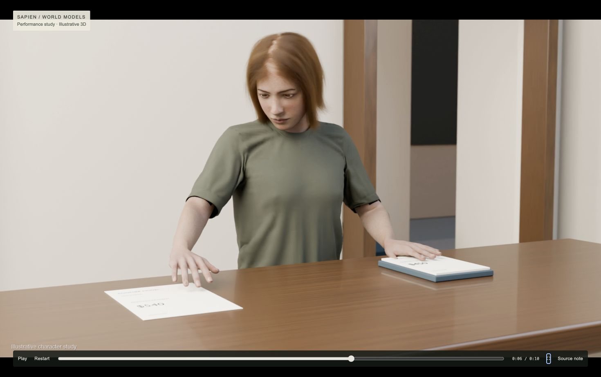

# Illustrative character performance test

Ten seconds of pre-rendered 3D: a person compares a $540 offer with a written $450 limit, moves the offer aside, releases it and looks up across the counter.



## Run the browser player

From the repository root:

```sh
node character-study/server.mjs
```

Open http://127.0.0.1:5194/. Set `PORT` to use another port. No package installation, API key, subscription or account is needed for this player. The server binds to loopback only.

- [Rendered master](public/media/character-performance.mp4): 1920 × 1080, 24 fps, ten seconds.
- [Actual browser recording](evidence/actual-browser.mp4): conformed to 30 fps for compatibility; final captured frame held through the end.
- [Three rendered frames](evidence/sequence-frames.jpg).
- [Review notes](REVIEW.txt).
- [Sources, licenses and credits](SOURCES.md).

The controls support play/pause, restart, seeking, fullscreen and source disclosure. The optional R keyboard shortcut records local playback into the ignored `captures/` folder. It does not upload to an external service.

## What this establishes

The source movie has 240 frames. Its full browser pass decoded all 240 with zero dropped video frames and one startup waiting event. Playback measurements describe video decoding, not real-time 3D rendering. The recorded wall time includes recorder finalization and local saving; see [the measured playback record](evidence/playback.json).

The revision improves gaze, eyelid closure, collar continuity, cloth movement, nail surfaces and the hand release. The face and hair still look digital in close-up; acting is restrained. For photographic hero close-ups, the recommended production change is a filmed performer under matching light.

## Scope

The person, values and response are authored illustrations. This is not an actual Sapien study, a finished World Models explanation, an explorable 3D neighborhood or a live simulation. It does not yet establish the person's history, connected journeys, alternative outcomes, population patterns or research findings. No official Sapien production release is asserted.

## Rendering sources

`rendering/` contains the authored Blender setup and refinement recipes for inspection. They require Blender 4.5, the separately sourced character data, prepared input scenes and motion inputs. Raw character files, CMU motion files, packed Blender projects and large intermediate caches are excluded. These recipes are not a one-command reconstruction from this checkout; [RENDERING.md](RENDERING.md) explains the missing prerequisites. The browser player above is complete and runs directly from this checkout.
